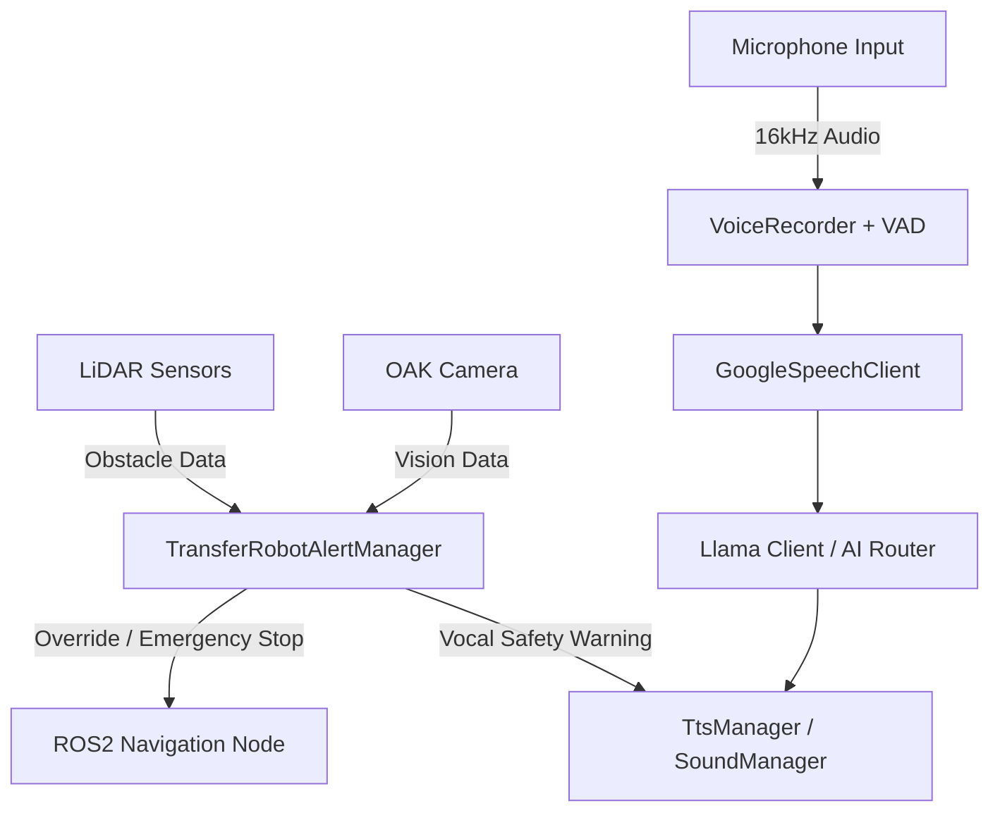

# 🤖 Transfer Robot
> **Control System & Multi-Language AI Voice Assistant**

> **Public repository scope:** This repository contains project documentation and screenshots only. Source code, build files, and runnable binaries are not included in this checkout. Implementation details below describe the project and cannot be independently verified from this repository.

This repository documents the software architecture of a **Transfer Robot**, combining a **ROS2** hardware control framework with a **Qt/QML** Graphical User Interface (GUI).

The system coordinates real-time hardware risk management, local/cloud AI routing, an LLM-powered (Llama) voice assistant, and multi-modal vision processing.

---

## 🛠 Tech Stack

- **GUI Framework:** Qt 5 / Qt 6 (Core, Gui, Qml, Quick)
- **Robotics:** ROS2 (Humble / Jazzy core libraries - `rclcpp`)
- **AI & Audio:** Local Llama (Edge), Cloud AI Router, Google Speech STT, VAD
- **Vision & Hardware:** Luxonis OAK Depth/RGB Camera, LiDAR Sensors
- **Networking & System:** `libcurl`, Multi-threading (`std::thread`, `QThread`)

---

## ✨ Key Features

### 💻 Hybrid GUI & Cross-Platform Support
* **Qt/QML (Fusion Style) Interface:** Provides an intuitive, fluid, and highly responsive UI powered by high-speed C++ backend data binding via `QML Context Property`.
* **Multi-OS Compilation:** Designed with `#ifndef _WIN32` preprocessor directives to separate the production Linux environment (full ROS2/Hardware integration) from the Windows environment (for UI mocking and debugging).

### 🎯 ROS2 Autonomous Navigation & Hardware Interactivity
* **Native ROS2 Integration:** Connects directly to robot control components using `rclcpp::Node` and a dedicated `RosInterface`.
* **Multi-Threaded Executor:** Utilizes a standalone C++ thread (`std::thread`) for the background ROS spin (`exec.spin()`). This separates ROS event processing from the main UI thread.
* **Sensor Management:** Processes immediate hazard feedback using an integrated `LidarManager` and obstacle detection bounding boxes.

### 🎙️ Intelligent Voice Assistant & TTS Pipeline
* **Hybrid Edge/Cloud AI:** Features a local `LlamaClient` for offline interaction and an `AiRouterClient` for cloud-based smart AI routing.
* **Real-Time Audio Pipeline:** Streams microphone input through `VoiceRecorder` (16kHz with VAD/Threshold detection) $\rightarrow$ `GoogleSpeechClient` (STT) $\rightarrow$ `LLM Inference` $\rightarrow$ `SoundManager` (TTS).
* **Flexible Exceptions:** Supports environment variables (e.g., `TRANSFER_ROBOT_DISABLE_INTERNAL_TTS`) to dynamically mute audio feedback during specific operation modes (e.g., shooting/media mode).

### 👁️ High-Performance Vision Pipeline (Depth & Skeleton)
* **Isolated Thread Execution:** The `CameraManager` worker is offloaded to a dedicated `QThread` (`moveToThread`) to keep camera work separate from UI rendering.
* **OAK Camera & Skeleton Tracking:** Drives a low-power standby pipeline capable of human detection (`personFoundChanged`), distance tracking (`distanceUpdated`), and frame rendering via `VideoItem`.
* **Risk Evaluation Engine:** Feeds vision and LiDAR-based `ObstacleSummary` packages straight into the `TransferRobotAlertManager` to alter robot paths or issue emergency stops.

---

## 🏗 System Architecture & Data Flow

The application relies heavily on an **Event-Driven Architecture**. Thread-safe communication across different layers is handled natively via Qt's Signals & Slots mechanism using `Qt::QueuedConnection`.

## Deployment scope

The described production environment integrates Linux, ROS 2, and robot hardware. The Windows path is intended for UI mocking and debugging; it is not equivalent to the hardware deployment. Qt and ROS 2 versions listed above describe alternatives, not a verified compatibility matrix.

No build scripts, robot configuration, model files, or test data are included here, so this checkout is not runnable. Cloud routing and Google speech recognition require network services; local LLM inference alone does not make the complete voice pipeline offline. No navigation, latency, or safety-validation benchmark is published in this repository.
